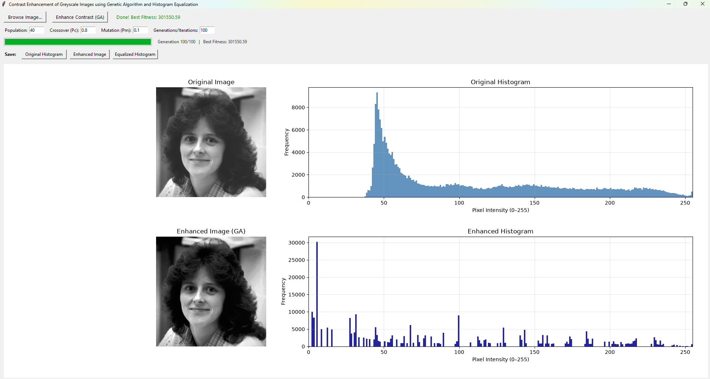

# GA-HistEQ
A Python image processing application for automatic greyscale image contrast enhancement by optimizing histogram equalization with a Genetic Algorithm.



## Features

- Load grayscale images.
- Display the original image and its histogram.
- Enhance image contrast using a Genetic Algorithm.
- Display the enhanced image and its histogram side by side.
- Configure Genetic Algorithm parameters, including population size, crossover rate, mutation rate, and number of generations.
- Monitor algorithm progress through a real-time progress bar and best fitness score.
- Save the original histogram, enhanced image, and enhanced histogram individually.

## Methodology

The method uses a Genetic Algorithm to find an effective mapping of grayscale intensity levels to improve image contrast.

### 1. Chromosome Representation

Each chromosome represents a candidate grayscale-level mapping, implemented as a sorted array of intensity values.

The chromosome follows two constraints:

- The first gene is fixed at `0`.
- The last gene is fixed at `255`.

This representation keeps the mapping within the valid grayscale intensity range while preserving the ordering of intensity levels.

### 2. Fitness Function

The fitness of each chromosome is evaluated using edge information from the resulting enhanced image:


\[
\mathrm{fitness}(X) =
\log(\log(E(I(X)))) \times n_{\mathrm{edges}}(I(X))
\]

**Where:**

- \(X\) is a chromosome representing a candidate grayscale mapping.
- \(I(X)\) is the enhanced image obtained by applying chromosome \(X\) to the original image.
- \(E(I(X))\) is the total edge intensity of the enhanced image.
- \(n_{\text{edges}}(I(X))\) is the number of detected edge pixels.

#### Edge Intensity

The total edge intensity is calculated as:

\[
E(I(X)) =
\sum_x \sum_y
\sqrt{
\delta h_1(x,y)^2 +
\delta v_1(x,y)^2
}
\]

Where:

- \(\delta h_1(x,y)\) represents the horizontal gradient component.
- \(\delta v_1(x,y)\) represents the vertical gradient component.

These gradient components are calculated using Sobel-like operators. Higher edge intensity indicates stronger image gradients and potentially more pronounced image details.

#### Rationale Behind the Fitness Function

The fitness function combines two measures of image quality:

- **Number of edge pixels:** Rewards mappings that produce more detectable edges in the enhanced image.
- **Total edge intensity:** Rewards mappings that produce stronger gradients and more pronounced edges.

The double logarithmic transformation, \(\log(\log(E))\), reduces the influence of extremely large edge-intensity values on the fitness score.

By combining these measures, the Genetic Algorithm searches for a grayscale mapping that enhances image contrast and emphasizes visual details.

### 3. Genetic Operators

The Genetic Algorithm uses the following operators:

| Operator | Method |
|---|---|
| Selection | Roulette Wheel Selection |
| Crossover | Two-Point Crossover |
| Mutation | Constrained Mutation (preserving sorted order) |

## Requirements

- Python 3.8 or later
- OpenCV
- NumPy
- Matplotlib
- Tkinter

### Installation

Install the required Python packages:

```bash
pip install -r requirements.txt
```

## How to Run

Clone the repository:

```bash
git clone <repository-url>
cd <repository-folder>
```

Run the application:

```bash
python main.py
```

### Using the Application

1. Click **Browse Image...** and select a grayscale image.
2. Optionally adjust the Genetic Algorithm parameters.
3. Click **Enhance Contrast (GA)** to start the enhancement process.
4. Monitor the algorithm's progress and best fitness score.
5. Once the process finishes, inspect the enhanced image and its histogram.
6. Use the corresponding **Save** buttons to export the results.

## Genetic Algorithm Parameters

| Parameter | Default Value | Description |
|---|---:|---|
| Population Size | 40 | Number of chromosomes in each generation. |
| Crossover Rate (Pc) | 0.8 | Probability of applying crossover. |
| Mutation Rate (Pm) | 0.1 | Probability of applying mutation. |
| Generations | 100 | Number of generations in the evolutionary process. |

## Reference

This implementation is based on the following research paper:


[An Image Enhancement Method Based on Genetic Algorithm](https://api.semanticscholar.org/CorpusID:17083663)


